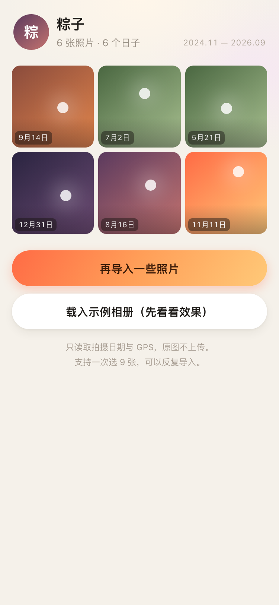
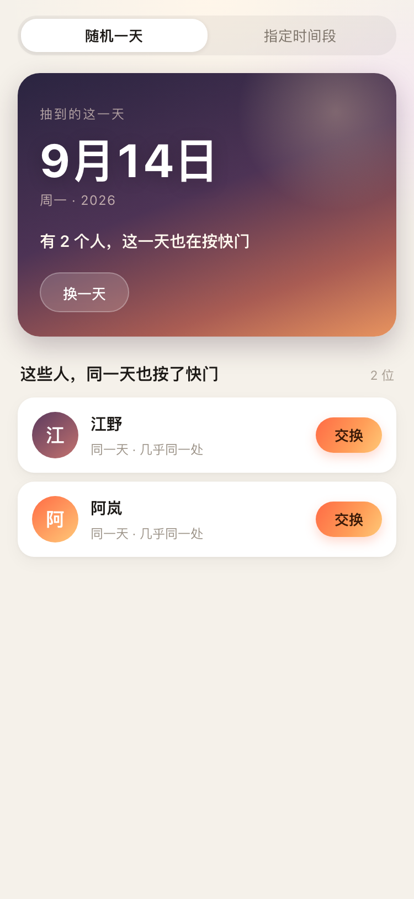
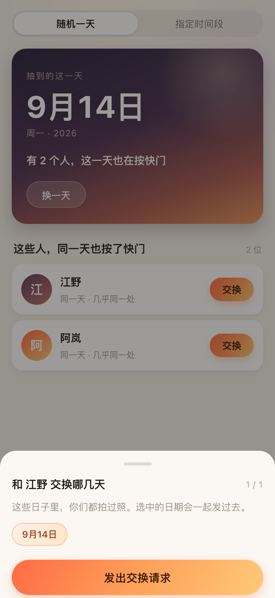
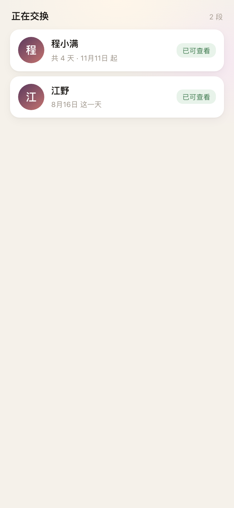
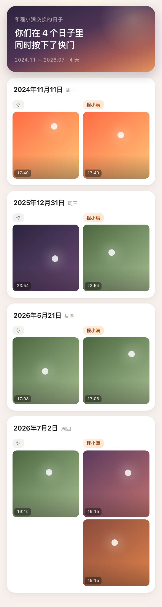
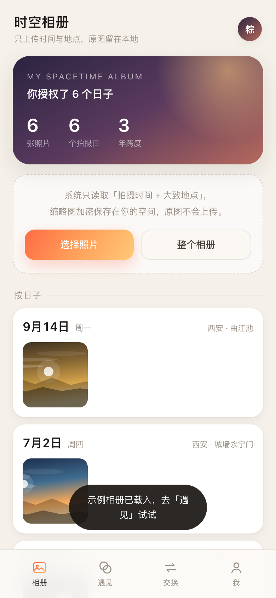

<p align="center">
  
</p>

<h1 align="center">时空相册 · Spacetime Album</h1>

<p align="center"><sub>在那些我们还不认识的日子里，我们看过同一片天。</sub></p>

一个很轻的实验：**两个陌生人，交换彼此在同一天拍下的照片。**

微信小程序端（微信云开发）+ 网页版两个前端，共用同一套接口语义。

你授权自己相册里的照片，系统只读取每张照片的**拍摄日期**和**大致地点**。然后它随机抽一个日子 —— 或者由你指定一段时间 —— 去找那天也在按快门的人。匹配时看不到任何照片；只有双方都按下「展示」之后，那一天的照片才会互相可见。

灵感来自一次整理相册：一张风景照，出现在我们还没认识的时间里。原来在某年某天，她经历过这样的一天，见过这样一片火烧云 —— 那会不会，我们还没相识的时候，曾在同一时间对着同一片云按下快门？

<p align="center">
  
  
  
  
</p>
<p align="center">
  
  
  
</p>
<p align="center">
  <sub>微信小程序端 · 授权相册 → 随机一天 → 选日子 → 双方同意后交换那一天的照片<br/>（最后一图为同一套接口的网页版）</sub>
</p>

---

## 现在能做什么

| 环节 | 说明 |
| --- | --- |
| 授权相册 | 微信端 `wx.chooseMedia` 选图，手机上直接解析 EXIF，取拍摄时间 + GPS；网页端选若干张或整个文件夹 |
| 时光概览 | 按日子归拢照片，显示授权了多少张、多少个拍摄日、跨了多少年 |
| 随机一天 | 从你的相册里抽一个日子，列出那天也在拍照的人 |
| 指定时间 | 给定起止日期，找出所有重合的日子与候选人，按重合天数排序 |
| 发起交换 | 勾选要交换的日子（默认全选），发送请求 |
| 双方同意 | 对方接受后进入交换房间；两边各自「展示」，都展示完才互相可见 |
| 交换房间 | 按日子左右对照「你 / TA」，标注各自按快门的时刻 |
| 随时收回 | 单张取消授权，或一键清空全部授权（进行中的交换一并结束） |

演示账号会自动回应：发起请求约 4 秒后被接受，你按下展示约 9 秒后 TA 也按下展示 —— 一个人也能走完整条链路。

## 隐私设计

这是整个产品的底线，也是一切交互设计的前提：

1. **原图不出设备。** 照片在设备上（浏览器或手机）被压成 720px 的缩略图，只上传缩略图，原图始终留在本地。
2. **匹配只看元数据。** 匹配阶段比对的是「日期」和「坐标」，任何人（包括服务端）都不会把照片发给未确认的对方。
3. **双向确认后才能看。** 配对需要对方同意；展示需要双方各自按下按钮。任何一方不按，另一方永远看不到。
4. **可撤回。** 授权是逐张的，随时能删；清空授权即退出所有交换。
5. **匿名。** 不需要手机号，昵称就是身份，坐标只用于算距离，不在界面上显示原始经纬度。
6. **轮询不带照片。** 交换房间每 3 秒只问一次「对方按了没」，状态真的翻转时才去拉图。

## 技术结构

小程序端刻意做到**零依赖**：没有框架、没有构建步骤、`npm install` 都不用跑；后端是微信云开发，也不用自己买服务器。

```
.
├── miniprogram/                    # 微信小程序端（原生，无框架）
│   ├── app.js / app.json / app.wxss
│   ├── config.js                   # 云环境 ID（CLOUD_ENV）
│   ├── cloudfunctions/api/         # 后端：单云函数多路由
│   │   ├── index.js                # 路由 + 匹配算法 + 配对状态机
│   │   ├── demo.js                 # 演示用户与示例相册
│   │   ├── package.json
│   │   └── config.json             # 云函数配置（超时等）
│   ├── utils/
│   │   ├── exif.js   # 手写 EXIF 解析器，只读文件头 256KB
│   │   ├── photo.js  # 选图 → EXIF → 压缩 720px → 传云存储
│   │   ├── api.js    # wx.cloud.callFunction 封装，401 自动回登录
│   │   └── ui.js     # 日期 / 距离 / 渐变格式化
│   └── pages/
│       ├── login/    # 起名字，身份由 OPENID 决定
│       ├── album/    # 照片网格、导入、载入示例
│       ├── match/    # 随机一天 / 指定时间段 → 选日子
│       ├── pairs/    # 收到的请求 / 等待中 / 正在交换
│       └── room/     # 左右对照 + 双向展示
├── server/                         # 网页版的 Node 服务（零依赖，原生 http）
│   ├── index.js    # HTTP 路由 + 同一套匹配算法
│   ├── db.js       # JSON 文件持久化（原子写 + 延迟落盘）
│   ├── seed.js     # 演示用户与「天空」示例图
│   └── util.js     # id / 哈希 / SVG 渐变天空
├── public/                         # 网页版（浏览器直接打开）
│   ├── index.html
│   ├── app.js      # 原生 DOM，模板字符串渲染
│   ├── exif.js     # 与小程序端同源的解析逻辑
│   └── style.css   # 移动端优先，日落色系
├── scripts/
│   ├── deploy.sh     # 部署云函数
│   ├── upload.sh     # 上传体验版
│   ├── test-cloud.js # 内存 mock 跑云函数全链路（无需云环境）
│   ├── probe-cloud.js/probe-ui.js  # 借开发者工具自动化接口真机前验证
│   └── push-api.js   # 网络推不动时，用 Git Data API 推送
├── docs/
└── data/                          # 网页版运行时生成（已在 .gitignore 中）
```

### 为什么后端不是自己的服务器

小程序真机 / 体验版会**强制校验 request 合法域名**，域名必须已完成 ICP 备案。「不校验合法域名」这个开关只在开发者工具本地生效。临时隧道域名（Cloudflare 之类）不是自己的、备不了案、也没法在根目录放校验文件，永远进不了白名单 —— 真机上必然「连不上服务器」。

云开发的 `wx.cloud.callFunction` 走微信内部通道，不经过域名校验，所以选它。代价是网页版没法复用这套通道，于是保留了一份 Node 服务实现同样的接口语义。

### 匹配算法

- **日期集合**：`D(u) = { 用户 u 授权过的所有拍摄日 }`
- 重合日：`D(a) ∩ D(b)`
- **随机一天**：在「有人重合的日子」里抽，优先抽从未交换过的日子，避免重复
- **指定时间**：先按区间过滤 `D(a)`，再逐个用户求交集，按重合天数降序、距离升序排列
- **距离**：同一天里两人照片坐标的哈弗辛距离最小值，界面上化作「同一座城 / 相距 12 公里」

### 接口

小程序端全部走 `wx.cloud.callFunction({ name: 'api', data: { path, method, body } })`，云端按 `path` 分发；网页版是同一批路径的 HTTP 实现。身份不再用 token：小程序取 `OPENID`，网页版用昵称换 token。

| 方法 | 路径 | 说明 |
| --- | --- | --- |
| GET | `/api/health` | 健康检查（返回用户数、照片数、当前后端类型） |
| POST | `/api/wx/login` | 小程序登录：`{name}`，身份由 OPENID 决定 |
| GET | `/api/me` | 当前用户与相册统计 |
| GET/POST | `/api/photos` | 列出 / 批量新增授权照片（只收日期、坐标、云存储 fileID） |
| DELETE | `/api/photos/:id` | 取消单张授权 |
| POST | `/api/match` | `{mode:"random"}` 或 `{mode:"range",from,to}` |
| GET | `/api/pairs` | 收到的请求 / 发出的请求 / 进行中的交换 |
| POST | `/api/pairs` | 发起交换 `{toUserId, dates[]}` |
| POST | `/api/pairs/:id/respond` | 接受或婉拒 `{accept:true}` |
| POST | `/api/pairs/:id/reveal` | 展示自己的照片 |
| GET | `/api/pairs/:id/state` | 轮询专用：只有状态，没有照片 |
| GET | `/api/pairs/:id` | 交换房间数据（未双向展示时对方照片为空） |
| POST | `/api/demo/sample` | 给当前用户载入一份示例相册 |

云端数据落在 4 个集合：`users`（`_id` = openid）、`photos`、`pairs`、`meta`。首次被调用时自动建集合并播种 3 位演示用户 —— 所以刚开通的环境，进去就能匹配到人。

## 跑起来

### 1. 小程序端（推荐）

```bash
# 一次性：把环境 ID 填进 miniprogram/config.js 的 CLOUD_ENV
./scripts/deploy.sh <环境ID>        # 部署云函数
```

```
微信开发者工具 → 导入项目 → 目录选 miniprogram/ → 填自己的 AppID
→ 编译
```

起个名字 → 「载入示例相册」→「遇见」→ 随机一天 → 交换 → 等 4 秒 → 进房间 → 按展示 → 等 9 秒，就能看到对面的那一天。

云开发免费额度够用：2025-02-19 起，没有云环境的账号可建 1 个免费环境，小程序未发布上线期间不需要续费。开通细节见 [`docs/云开发开通.md`](docs/云开发开通.md)。

上传体验版：

```bash
./scripts/upload.sh 1.0.3 "说明"     # 传完去后台「版本管理」选为体验版
```

### 2. 网页版

```bash
node server/index.js     # 默认 http://localhost:4173
```

需要 Node 18+。首次启动会自动写入 3 位演示用户（阿岚 / 程小满 / 江野），他们各自在西安、成都、华山拍过一些日子。浏览器打开 `http://localhost:4173` 就是同一套逻辑的网页实现，适合对比和调试。

### 3. 改动之后怎么验

```bash
node scripts/test-cloud.js       # 内存 mock 跑云函数全链路，不需要云环境
```

如果要连带界面一起验，用开发者工具的自动化接口（`miniprogram-automator`）驱动模拟器，`scripts/probe-cloud.js` 验云函数连通性，`scripts/probe-ui.js` 把五个页面真点一遍并截图。手机扫码之前就能把链路验掉。

`git push` 在这个网络环境下经常报 `Empty reply from server`，此时用 `node scripts/push-api.js` 走 GitHub Git Data API 推送。

## 网页版 → 小程序端，换掉了什么

| 能力 | 网页版 | 小程序端 |
| --- | --- | --- |
| 选照片 | `<input type="file" multiple>` | `wx.chooseMedia({ sizeType: ['original'] })` |
| 读 EXIF | `File.slice().arrayBuffer()` | `FileSystemManager.readFile({ position, length })` 只读前 256KB |
| 压缩 | `canvas.toBlob(jpeg, 0.72)` | `wx.compressImage({ compressedWidth: 720 })` |
| 上传 | `fetch` + JSON（base64 塞进请求体） | `wx.cloud.uploadFile` 传云存储，拿 `cloud://` fileID，`<image>` 原生可用 |
| 登录 | 昵称 → token | `cloud.getWXContext().OPENID`，微信保证可信，不需要自己签 token |
| 轮询 | `setInterval` + fetch | `setInterval` + 轻量 `/state`，状态翻转才拉图 |
| 示例图 | SVG data URL（浏览器能画） | 小程序 `<image>` 不认 SVG，改走 WXSS 渐变占位 |

最后一条是个小坑：照片记录上带一个 `svg: true/false`，小程序据此决定渲染 `<image>` 还是渐变块。真实用户照片走 `<image>`，只有演示数据是「天空」渐变。

## 路线图

- [ ] 「同一片天」：同一天 + 距离 < 50km 时给出更强的提示，甚至比对天空颜色
- [ ] 那天的天气/日落时间，作为交换房间的注脚
- [ ] 反向地理编码，把坐标变成「西安 · 曲江池」这样的地名
- [x] 照片挪到对象存储（小程序端已用云存储，网页版仍在 JSON 里）
- [ ] 服务端 EXIF 解析，兜住 HEIC 和没有 EXIF 的照片（现在直接跳过）
- [ ] 举报与内容审核（陌生人交换照片必须要有）
- [ ] 小程序订阅消息：对方接受 / 对方展示了，推一条

## License

MIT
