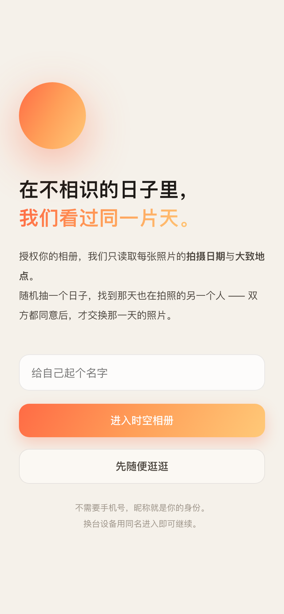
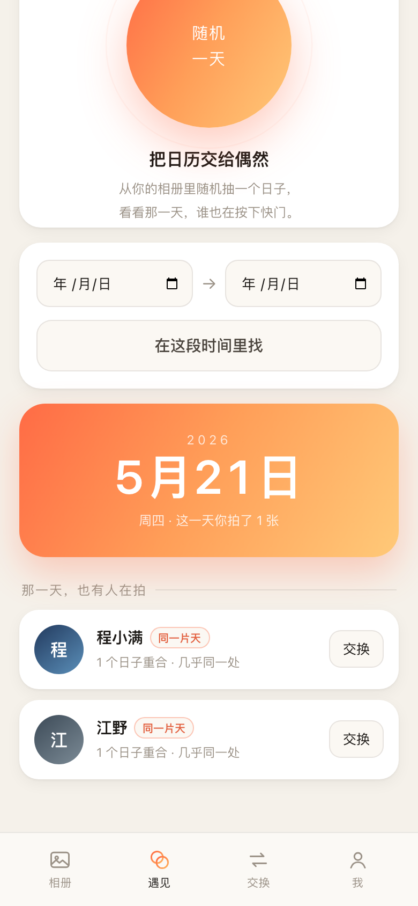
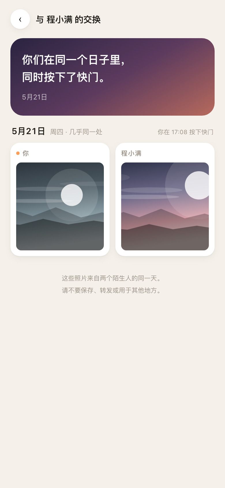

# 时空相册 · Spacetime Album

> 在那些我们还不认识的日子里，我们看过同一片天。

一个很轻的实验：**两个陌生人，交换彼此在同一天拍下的照片。**

你授权自己相册里的照片，系统只读取每张照片的**拍摄日期**和**大致地点**。然后它随机抽一个日子 —— 或者由你指定一段时间 —— 去找那天也在按快门的人。匹配时看不到任何照片；只有双方都按下「展示」之后，那一天的照片才会互相可见。

灵感来自一次整理相册：一张风景照，出现在我们还没认识的时间里。原来在某年某天，她经历过这样的一天，见过这样一片火烧云 —— 那会不会，我们还没相识的时候，曾在同一时间对着同一片云按下快门？

<p align="center">
  
  
  
  
</p>
<p align="center">
  <sub>授权相册 · 随机一天 · 双方同意后交换那一天的照片</sub>
</p>

---

## 现在能做什么

| 环节 | 说明 |
| --- | --- |
| 授权相册 | 选择若干张照片，或整个文件夹。浏览器本地解析 EXIF，取拍摄时间 + GPS |
| 时光概览 | 按日子归拢照片，显示授权了多少张、多少个拍摄日、跨了多少年 |
| 随机一天 | 从你的相册里抽一个日子，列出那天也在拍照的人 |
| 指定时间 | 给定起止日期，找出所有重合的日子与候选人，按重合天数排序 |
| 发起交换 | 勾选要交换的日子（默认全选），发送请求 |
| 双方同意 | 对方接受后进入交换房间；两边各自「展示」，都展示完才互相可见 |
| 交换房间 | 按日子并排展示「你 / TA」的照片，标注时间与两人当天最近的距离 |
| 随时收回 | 单张取消授权，或一键清空全部授权（进行中的交换一并结束） |

演示账号会自动回应：发起请求约 4 秒后被接受，你按下展示约 9 秒后 TA 也按下展示 —— 一个人也能走完整条链路。

## 隐私设计

这是整个产品的底线，也是一切交互设计的前提：

1. **原图不出设备。** 照片在浏览器里被读成 640px 的缩略图（JPEG q=0.72），只上传缩略图，原图始终留在本地。
2. **匹配只看元数据。** 匹配阶段比对的是「日期」和「坐标」，任何人（包括服务端）都不会把照片发给未确认的对方。
3. **双向确认后才能看。** 配对需要对方同意；展示需要双方各自按下按钮。任何一方不按，另一方永远看不到。
4. **可撤回。** 授权是逐张的，随时能删；清空授权即退出所有交换。
5. **匿名。** 不需要手机号，昵称就是身份，坐标只用于算距离，不在界面上显示原始经纬度。

## 技术结构

刻意做到**零依赖**：没有框架、没有构建步骤、`npm install` 都不用跑。

```
.
├── server/
│   ├── index.js    # HTTP 服务 + 路由 + 匹配算法（Node 原生 http）
│   ├── db.js       # JSON 文件持久化（原子写 + 延迟落盘）
│   ├── seed.js     # 演示用户与「天空」示例图
│   └── util.js     # id / 哈希 / SVG 渐变天空
├── public/
│   ├── index.html
│   ├── app.js      # 全部界面逻辑（原生 DOM，模板字符串渲染）
│   ├── exif.js     # 手写 EXIF 解析器：DateTimeOriginal + GPS
│   └── style.css   # 移动端优先，日落色系
└── data/db.json    # 运行时生成（已在 .gitignore 中）
```

### 匹配算法

- **日期集合**：`D(u) = { 用户 u 授权过的所有拍摄日 }`
- 重合日：`D(a) ∩ D(b)`
- **随机一天**：在「有人重合的日子」里抽，优先抽从未交换过的日子，避免重复
- **指定时间**：先按区间过滤 `D(a)`，再逐个用户求交集，按重合天数降序、距离升序排列
- **距离**：同一天里两人照片坐标的哈弗辛距离最小值，界面上化作「同一座城 / 相距 12 公里」

### 接口

| 方法 | 路径 | 说明 |
| --- | --- | --- |
| POST | `/api/login` | 昵称换 token（同名即同一身份） |
| GET | `/api/me` | 当前用户与相册统计 |
| GET/POST | `/api/photos` | 列出 / 批量新增授权照片（只收日期、坐标、缩略图） |
| DELETE | `/api/photos/:id` | 取消单张授权 |
| POST | `/api/match` | `{mode:"random"}` 或 `{mode:"range",from,to}` |
| GET | `/api/pairs` | 收到的请求 / 发出的请求 / 进行中的交换 |
| POST | `/api/pairs` | 发起交换 `{toUserId, dates[]}` |
| POST | `/api/pairs/:id/respond` | 接受或婉拒 `{accept:true}` |
| POST | `/api/pairs/:id/reveal` | 展示自己的照片 |
| GET | `/api/pairs/:id` | 交换房间数据（未双向展示时对方照片为空） |
| POST | `/api/demo/sample` | 给当前用户载入一份示例相册 |

## 本地运行

```bash
node server/index.js     # 默认 http://localhost:4173
```

需要 Node 18+。首次启动会自动写入 3 位演示用户（阿岚 / 程小满 / 江野），他们各自在西安、成都、华山拍过一些日子。

打开后：起个名字 → 「载入示例相册」→ 「遇见」→ 随机一天 → 发起交换 → 等 4 秒 → 进房间 → 按展示 → 等 9 秒，就能看到对面的那一天。

## 为什么是网页而不是原生小程序

这一版是**可直接运行的产品原型**：用同一套接口，把 `public/` 换成微信小程序的 `pages/` 即可 —— 匹配、授权、双向展示的逻辑都在服务端，前端只负责三件事：选照片、渲染日子、按展示。

移植到微信小程序需要的替换点：

| 网页版 | 小程序版 |
| --- | --- |
| `<input type="file">` 选照片 | `wx.chooseMedia` / `wx.chooseMessageFile`，或用 `wx.getUserProfile` 之外的相册授权 |
| 浏览器解析 EXIF | 小程序端读 EXIF 需走 `wx.getImageInfo` + 原生插件；更稳的做法是上传到云函数用 `sharp`/`exifr` 解析 |
| `fetch` + `x-token` | `wx.request` + `header`，登录换成 `wx.login` 的 code 换 openid |
| 本地缩略图 | 上传到对象存储（云开发 storage），按 pair 授权下发临时链接 |

## 路线图

- [ ] 「同一片天」：同一天 + 距离 < 50km 时给出更强的提示，甚至比对天空颜色
- [ ] 那天的天气/日落时间，作为交换房间的注脚
- [ ] 反向地理编码，把坐标变成「西安 · 曲江池」这样的地名
- [ ] 服务端 EXIF 解析（支持 HEIC），摆脱浏览器解码限制
- [ ] 真正的小程序端 + 云开发存储
- [ ] 举报与内容审核（陌生人交换照片必须要有）

## License

MIT
